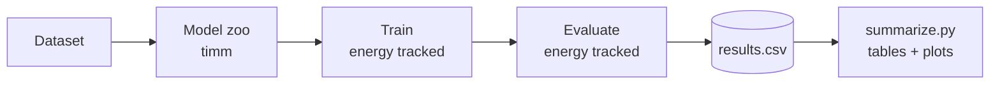

<h1 align="center">🌱 Carbon Footprint of Deep Learning Models</h1>

<p align="center">
  <b>How much CO₂ does it cost to teach a model to see?</b><br>
  Measuring the energy and carbon emissions of training and running vision models, side by side with their accuracy.
</p>

<p align="center">
  
  
  
  
  
</p>

---

## 🔍 Why this project?

AI models keep getting bigger, and so does the electricity bill behind them. Accuracy leaderboards rarely show what a model *costs* the planet. This project measures that cost directly, so that "which model is best?" can also mean "which model is best **per gram of CO₂**?"

> 🚧 **Status: ongoing research.** The measurement pipeline is working; experiments and analysis are in progress. No results are published yet.

## ⚙️ What it measures

For every training run, the pipeline records:

| Category | Metrics |
|---|---|
| 🎯 **Quality** | Test accuracy, macro-F1 |
| ⚡ **Energy** | Training energy (Wh) and inference energy (Wh), measured separately |
| 🌍 **Carbon** | CO₂e emitted during training and during inference |
| 🧮 **Complexity** | FLOPs and parameter count |
| ⏱️ **Time** | Wall-clock training time |

## 🧭 Pipeline



## 🧠 Models

CNNs and transformers, built through [`timm`](https://github.com/huggingface/pytorch-image-models) with ImageNet-pretrained weights:

`ResNet18` · `ResNet50` · `MobileNetV3-Small` · `EfficientNet-B0` · `ConvNeXt-Tiny` · `ViT-Tiny` · `DeiT-Small`

## 🗂️ Datasets

- ✅ **EuroSAT** (satellite land-use classification): implemented
- 🔜 More datasets from other domains: planned

## 🚀 Quick start

```bash
git clone https://github.com/ShreeyaTapaswi/Carbon-Footprint-of-DL-Models.git
cd Carbon-Footprint-of-DL-Models
pip install -r requirements.txt

# one run
python train.py --model resnet18 --epochs 5 --seed 0

# all models, 3 seeds each
./run_all_models.sh

# tables and carbon charts from results/results.csv
python summarize.py
```

Every run prints a summary like this:

```
====================================================
 resnet18 | seed 0 | 5 epochs
 Test macro-F1        : ...
 Training energy      : ... Wh
 Training CO2 emitted : ... g CO2e
 Inference CO2 emitted: ... g CO2e
====================================================
```

## 📁 Project structure

```
├── train.py            # train one model with energy tracking
├── summarize.py        # aggregate results, make carbon charts
├── run_all_models.sh   # batch runner
├── src/
│   ├── models.py       # model zoo
│   ├── data.py         # dataset loaders
│   └── energy.py       # codecarbon + FLOPs/params (thop)
└── results/            # run outputs (CSV, plots)
```

## 🛠️ Built with

PyTorch · timm · [codecarbon](https://github.com/mlco2/codecarbon) · [thop](https://github.com/Lyken17/pytorch-OpCounter) · scikit-learn · pandas · matplotlib

## 🗺️ Roadmap

- [x] Training pipeline with energy and CO₂ tracking
- [x] EuroSAT support
- [ ] Additional datasets
- [ ] Full experiments and statistical analysis
- [ ] Paper

## 📄 License

Released under the [MIT License](LICENSE).

## 👩‍💻 Author

**Shreeya Tapaswi** · [GitHub](https://github.com/ShreeyaTapaswi)

---

<p align="center"><i>If you find this useful, a ⭐ is appreciated.</i></p>
